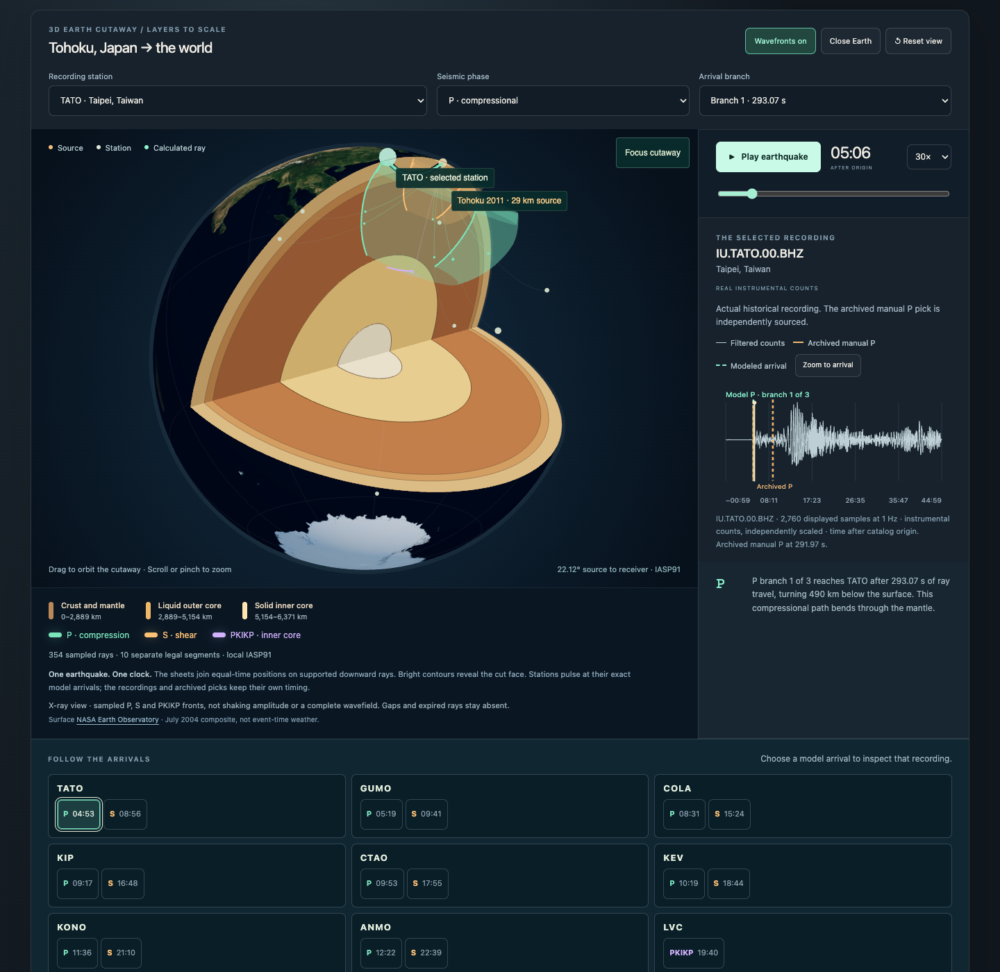

# Earthquake Lab

Replay a real earthquake, compare station recordings with calculated arrivals, then investigate where it began and how its rays travel through Earth.

Earthquake Lab is a local educational application with a Rust and WebAssembly numerical core. Its three curated events contain 21 real vertical recordings. Tohoku also has eight independently archived manual P picks for a bounded source-location exercise.



[Watch the recorded walkthrough](docs/media/wavefront-walkthrough.mp4) or follow [the investigation guide](docs/investigation-guide.md).

## What the demo shows

- **Replay the event.** Green P, amber S, and violet PKIKP fronts spread through a textured Earth. Exact modeled arrivals light the stations and line up with the recording playhead. Rewind reconstructs the earlier state.
- **Find its source.** Move a candidate around Japan, calculate signed timing residuals, fit the selected Tohoku observations, and reveal the historical catalog comparison.
- **Look inside Earth.** Orbit a quarter cutaway, follow an exact ray through the mantle or inner core, and compare the 3D view with an analytical section.
- **Compare the evidence.** Inspect separately scaled station recordings or a travel-time diagram containing every supported root at 90 sampled distances.
- **Keep an experiment.** Share identity-bound settings in a URL fragment or download calculation JSON and summary CSV.

The source exercise demonstrates model mismatch as well as a fit. The independent eight-station control has about 0.476 s residual RMS yet lies about 41.9 km from the catalog epicenter. Depth stays fixed at 29 km and origin time is fitted. A low residual is not a certificate of historical accuracy.

## Run locally

The source build uses Node.js 24, Rust 1.99.0, wasm-bindgen CLI 0.2.129, and Python 3 for the standard-library publication gate. The [developer guide](docs/development.md) lists prerequisites and troubleshooting.

```sh
gh repo clone steph4n-gh/earthquake-lab-publication
cd earthquake-lab-publication
rustup target add wasm32-unknown-unknown
cargo install wasm-bindgen-cli --version 0.2.129 --locked
npm ci
npm run build
npm run dev -- --port 5173 --strictPort
```

Open [the local lab](http://127.0.0.1:5173/). The build checks frozen scientific and visual assets, compiles the numerical core, and produces `dist/`. No account, credentials, database, Python, or Java runtime is needed by the application.

Calculations run locally in one module Worker. Playback and orbit reuse prepared paths and display buffers. Changed geometry and fitting work offline after loading. Reloading while disconnected is not supported. A localhost share link requires a compatible copy of the app at that origin. There is no hosted sharing service.

## Scientific scope

The engine implements a limited IASP91 ray-theory solver for downward uppercase P, S, and inner-core-transiting PKIKP. It supports surface receivers, source depths of 0 to 700 km, and distances of 1 to 179 degrees. Empty and multiple results are valid.

Animated fronts are finite sampled equal-time surfaces. They do not predict shaking amplitude, attenuation, a finite rupture, or the complete wavefield. Station cues use exact receiver calculations rather than intersections with a display mesh. The cutaway has a fixed quarter section in Earth coordinates. Orbit rotates the camera around it.

Recorded samples and archived picks retain their historical clocks when you change the modeled source. Recordings are filtered instrumental counts, independently scaled without instrument-response removal. Zero-phase filtering can spread energy before an onset. The pick archive omits numeric uncertainty and does not identify the specific displayed BHZ sensor. Only Tohoku has a qualified location exercise.

Read [the numerical contract](docs/numerical-contract.md), [the location method](docs/location-experiment.md), and [the wavefront contract](docs/wavefront-contract.md) before using the outputs beyond the demo.

## Verify and develop

```sh
npm run check:project
cargo test --release --locked
npm test
npm run build
npm run verify:distribution
cargo build --release --locked
npm run verify
```

The browser suites require installed Google Chrome. They exercise public controls, native comparisons, shared links, exports, cancellation, offline recomputation, and touch-enabled desktop layouts. The [verification guide](docs/verification.md) explains each gate, optional scientific Python checks, and generated evidence.

The frozen base and boundary corpora contain 635 reference arrivals across 260 queries. A separate strict held-out enumeration diagnostic fails in eight groups because Rust returns 16 additional close rays. A separate upstream shooting check recovers those rays. Both the negative result and its bounded reconciliation remain in [the curated evidence](docs/evidence/README.md). This is not complete TauP parity or proof of physical Earth accuracy.

[The documentation index](docs/README.md) maps the tutorial, developer procedures, scientific contracts, provenance, and historical measurements. [The verification skill](.cursor/skills/verify-taup-workbench/SKILL.md) maps maintenance checks to the actual UI.

## Project status and attribution

Version 0.1.0 is an [open-source educational preview](https://github.com/steph4n-gh/earthquake-lab-publication). [Open the lab](https://quakes.steph4n.dev/) without signing in. The [hosting instructions](docs/hosting.md) and [release checklist](RELEASE_CHECKLIST.md) describe deployment and qualification. This release uses a [narrow factual dataset and independent history](docs/publication-data.md); the original development repository and full source archives remain private. There is no registry package or operational earthquake service.

Application code is licensed under [LGPL-3.0-only](LICENSE). [NOTICE](NOTICE) and [THIRD_PARTY.md](THIRD_PARTY.md) preserve the limited ObsPy TauP adaptation, scientific references, and dependency notices. Data and imagery keep their separate source terms and credits. NASA Earth Observatory supplies the July 2004 surface composite, which does not represent event-time weather.

See [CONTRIBUTING.md](CONTRIBUTING.md) for contribution scope and [SECURITY.md](SECURITY.md) for reporting security problems.
